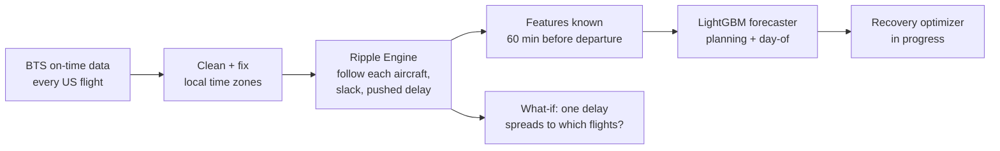

# SkyRecover

[](https://github.com/DaKSh32-blip/SkyRecover/actions/workflows/tests.yml)


**Predicts airline delays before they happen, and shows how one late plane ripples through the rest of the network.** Built on 227,855 real Delta flights from US government data.

> Status: forecasting and ripple modeling are working and validated. The recovery optimizer and ops dashboard are in progress (see [Roadmap](#roadmap)).

---

## The problem

Most airline delays aren't new problems. They're old ones passing forward. A plane lands 60 minutes late, it only has 50 minutes on the ground, so its next flight leaves late too, and so does the one after that. One delay at 7am can still be causing trouble at 9pm.

SkyRecover models that chain reaction, and predicts which flights are about to be hit while there's still time to act.

## Results

All numbers below come from real **US Bureau of Transportation Statistics** on-time data for **Delta Air Lines, January to March 2024**.

### 1. The ripple model matches what Delta reports

Airlines have to tell the government *why* each delayed flight was late. One official cause is "Late Aircraft," meaning the plane arrived late from its previous flight. That's exactly what the ripple engine estimates, so it can be checked against Delta's own reports.

| Check (29,400 delayed flights) | Result |
|---|---|
| Correlation with Delta's reported Late Aircraft delay | **0.85** |
| Agreement on whether a ripple happened | **85%** |

### 2. The forecaster predicts late departures an hour ahead

Trained on January and February, then tested on **82,427 March flights the model never saw**. Every feature is limited to information an airline would actually have **60 minutes before departure**.

| Model | Avg error (min) | AUC | Precision | Recall |
|---|---|---|---|---|
| Always guess on time | 10.94 | 0.50 | none | 0% |
| Typical delay for that airport and hour | 10.95 | 0.60 | 22% | 0% |
| Ripple formula alone (no ML) | 9.77 | 0.61 | 97% | 16% |
| SkyRecover, planning (schedule only) | 10.51 | 0.66 | 72% | 9% |
| **SkyRecover, day-of (schedule + live)** | **8.12** | **0.82** | **79%** | **43%** |

The day-of model catches **2.7x more late flights** than the ripple formula alone while staying right 79% of the time, and cuts average error by **26%** versus guessing on time. The strongest signal is how late the inbound aircraft landed, which confirms that ripples drive a large share of delays.

## How it works



**Ripple Engine.** Each aircraft is followed through its day using its tail number. For every flight:

```
slack        = ground time between flights - 35 min minimum turn
pushed delay = max(0, how late the inbound plane landed - slack)
```

The leftover delay keeps passing to the next flight until a long enough ground time absorbs it.

**Forecaster.** Gradient-boosted trees (LightGBM) using schedule features (turn slack, which leg of the day, hour, airports, schedule congestion) plus live features (inbound aircraft delay so far, average delay at the airport over the last three hours).

## Engineering notes

A few problems worth calling out:

- **Time zones.** BTS records times in local time at each airport. Computing arrival as "departure + flight time" silently mixes zones, and made cross-country ground times wrong by up to 3 hours. Fixing it dropped impossible turns (under 35 min) from 19% to 1.4%, and raised the ripple signal's correlation from 0.36 to 0.52. The same trap reappeared when checking whether an inbound flight had already departed, and was caught when two feature counts didn't add up.
- **No data leakage.** A feature is only used if it would be known an hour before departure. An inbound plane's landing delay is hidden if it hasn't landed yet. Tests in `tests/test_features.py` enforce this.
- **Honest evaluation.** A time-based split (train on earlier dates, test on a later month), plus three baselines, including the ripple formula on its own, so the ML has to beat simple physics, not just a coin flip.

## Quickstart

```bash
git clone https://github.com/DaKSh32-blip/SkyRecover.git
cd SkyRecover
python -m venv .venv
.venv\Scripts\Activate.ps1          # Windows (macOS/Linux: source .venv/bin/activate)
pip install -e ".[dev]"

skyrecover download --year 2024 --months 1 2 3   # real data from BTS, ~80 MB zipped
skyrecover prepare                               # clean into data/processed/flights.parquet
skyrecover ripple                                # validation + top delay spreaders
skyrecover ripple --flight-id 204225 --delay 90  # what if this flight lands 90 min late?
skyrecover train                                 # train + evaluate the forecaster
pytest                                           # 18 tests, no data download needed
```

## Project structure

```
src/skyrecover/
  data/download.py   download monthly BTS files
  data/clean.py      parse times, fix time zones, filter, one row per flight
  ripple.py          aircraft rotations, slack, delay propagation, BTS validation
  features.py        leakage-safe features (schedule + live)
  forecast.py        baselines, LightGBM models, time-split evaluation
  cli.py             the `skyrecover` command
tests/               unit tests, including leakage tests
docs/LEARNING_LOG.md design decisions and lessons, piece by piece
```

## Roadmap

- [x] Data pipeline from BTS with time-zone correction
- [x] Ripple engine, validated against airline-reported causes
- [x] Delay forecaster with leakage-safe features
- [ ] **Recovery optimizer:** when things break, swap aircraft and re-time flights to minimize total passenger delay (OR-Tools)
- [ ] **Ops dashboard:** web app with a delay map and click-to-see ripple chains
- [ ] **Ops copilot:** ask "what if we cancel DL1234?" in plain English, with an AI agent calling the simulator and optimizer as tools
- [ ] Weather features (NOAA) to strengthen the planning model
- [ ] Replay a real storm day and measure how much recovery would have saved

## Data

Flight data comes from the [Bureau of Transportation Statistics](https://www.transtats.bts.gov/) Reporting Carrier On-Time Performance dataset, which is public US government data. It isn't stored in this repo; `skyrecover download` fetches it.
